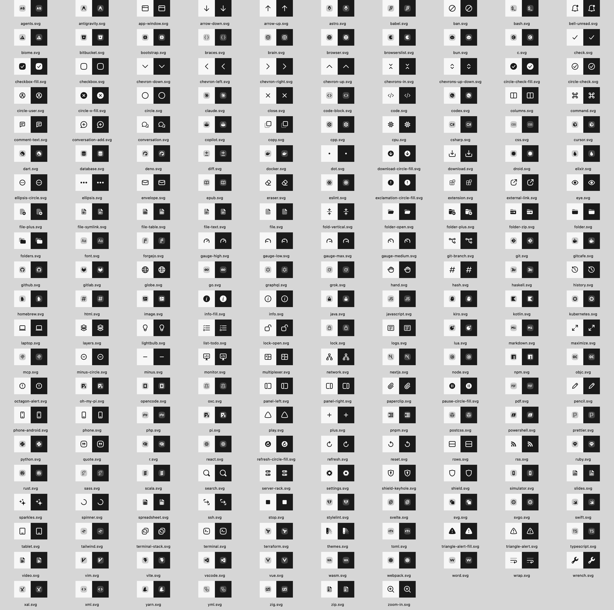

# CXL Icons

207 SVG icons for apps, developer tools, files and brands, adapted and extended for [Tab](https://github.com/hugocxl/tab).



## Use

Download or clone this repository and copy the SVGs you need from `icons/`.
No dependencies or build step are required to use the artwork.

```sh
git clone https://github.com/hugocxl/cxl-icons.git
```

Icons use `currentColor`, filled geometry and their original viewBox. Most are
16 units high; preserve aspect ratio when sizing them. Duo icons use opacity
for a secondary layer of the same color.

Inline an SVG in HTML to inherit CSS `color`. When loading SVGs through an
`` tag, parent CSS color does not propagate into the file. Native apps can
load them as template images and apply their own tint.

Open [index.html](index.html) locally for a searchable gallery of every icon.

## Swift / SwiftUI

The Swift package exposes the `TabIcons` library (Swift 6+, macOS 12+, iOS 15+,
tvOS 15+, watchOS 8+). In Xcode, add this repository as a **local package** while
preparing the first package release, then add `TabIcons` to your app target.
The existing 0.1.0 artwork tag does not include these adapters.

```swift
import TabIcons
import SwiftUI

TabIcon.search.image
    .resizable()
    .scaledToFit()
    .frame(width: 24, height: 24)
    .foregroundStyle(.secondary)
    .accessibilityLabel("Search")
```

Use `TabIcon.search.uiImage` in UIKit or `TabIcon.search.nsImage` in AppKit.
Images come from the package's vector asset catalog and use template rendering.
`TabIcon.allCases` and `TabIcon(rawValue: "search")` support dynamic selection.

## React

The npm packages are prepared locally; this change does not publish them.
From this repo, run `npm ci`, `npm run generate`, then
`npm pack --workspace @hugocxl/cxl-icons-react`. Install the resulting `.tgz`
file in your app with `npm install /path/to/the-package.tgz`.

```tsx
import { SearchIcon } from '@hugocxl/cxl-icons-react';
// Per-icon imports are also supported:
import { TerminalIcon } from '@hugocxl/cxl-icons-react/terminal';

<SearchIcon size={24} color="currentColor" aria-label="Search" />
<TerminalIcon size={16} />
```

Components support React 18 and 19, SVG props, and forwarded SVG refs.
Unlabelled icons are decorative (`aria-hidden`). Supply `aria-label` or
`aria-labelledby` for meaningful icons; explicit `aria-hidden` takes precedence.
For icon-only buttons, label the button and leave the icon decorative.

## React Native / Expo

Pack `@hugocxl/cxl-icons-react-native` with the same workflow and install its
`.tgz` in your app. Install its peer dependency `react-native-svg` too:
`npx expo install react-native-svg` for Expo, or `npm install react-native-svg`
for a bare app (then install iOS pods using your app's normal workflow).

```tsx
import { SearchIcon } from '@hugocxl/cxl-icons-react-native';

<SearchIcon size={24} color="#64748b" accessibilityLabel="Search" />
```

Native components accept `react-native-svg` props and refs. Use an explicit color
or your app's theme color. No SVG transformer or custom Metro configuration is
needed. Both npm packages ship typed ESM with per-icon exports and tree shaking.
The peer ranges are compatibility declarations; CI checks the versions in the
lockfile, not every older React Native release.

## Development and validation

Use Node 22+, npm, Python 3, and Xcode with Swift 6+ for Apple builds.

```sh
npm ci
npm run generate       # regenerate adapters after editing icons/
npm run validate       # artwork, generation drift, rendering, types, packaging
xcodebuild -scheme TabIcons -destination 'platform=macOS' test
xcodebuild -scheme TabIcons -destination 'generic/platform=iOS Simulator' CODE_SIGNING_ALLOWED=NO build
```

`icons/` is the source of truth. Commit generated `packages/*/dist` and
`Sources/TabIcons` resources so consumers do not need Python or a generation
step. Do not edit generated files directly. Build caches and dependencies are
ignored. CI validates JavaScript packages on Linux and Swift on macOS, including
an iOS Simulator build. Use Xcode for asset-catalog tests; standalone SwiftPM resource compilation varies
with the installed toolchain. Device rendering and a running React Native app still
need app-level verification.

Before a release, update both npm versions and the changelog, run validation,
inspect `npm pack --workspaces --dry-run`, and create a new Swift package tag
containing the adapters. Publishing and tagging are separate maintainer actions.

## Contribute

See [the drawing guide](scripts/icons/STYLE.md) for geometry and naming conventions.
Tools use Python 3's standard library; the contact sheet requires Swift and AppKit
on macOS.

```sh
python3 -I scripts/icons/normalize.py icons
python3 -I scripts/icons/test-adapt-brand.py
swift scripts/icons/render-sheet.swift icons preview.png --size 16 --scale 2
scripts/validate.sh
```

The importer and brand adapter in `scripts/icons/` help prepare new artwork.
Preserve upstream attribution when adapting artwork.

## License and attribution

Original Tab contributions and tooling are [MIT licensed](LICENSE).
The collection includes artwork adapted from Pierre Icons (Apache 2.0),
Pierre's file icons (MIT), Simple Icons (CC0 1.0), LobeHub Icons (MIT), and
Devicon (MIT). Upstream artwork retains its original license; the collection
is not solely MIT licensed. Keep [NOTICE](NOTICE),
[the upstream license texts](THIRD_PARTY_LICENSES.md), and applicable copyright
notices with redistributed artwork.

Brand marks remain the trademarks of their owners. Inclusion does not imply
endorsement or grant trademark rights.
