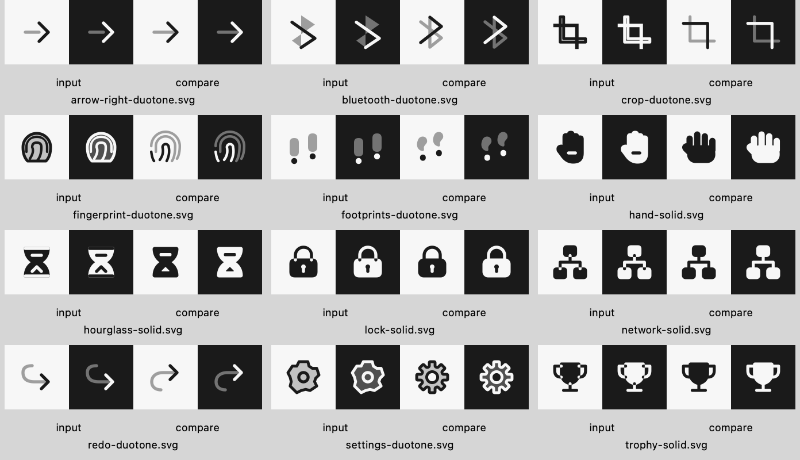

# Artwork review — 10 November 2026

> Historical review. The [stricter 11 November audit](DESIGN-AUDIT-2026-11-11.md)
> supersedes the all-approved design conclusion below and records remaining defects.
> The [selective-duotone follow-up](TONE-REVIEW.md) records the later tone correction.

The full delivered set was visually inspected: **550 names, 1,488 SVGs**, including
all supported Duotone, Solid and Stroke variants. Each row shows **16, 24 and 32
points on light and dark backgrounds**, rendered with AppKit at 2× resolution.
That is 8,928 rendered instances across 38 category sheets. The review included
the 81 legacy brand marks, which only support Duotone.

This is a Codex visual review, supported by geometry checks, not independent
human design certification. No known blocking findings remain from this pass.
The review does not establish parity with the breadth or optical tuning of SF
Symbols, Hugeicons or Lucide. Live browser rasterization, physical devices and
React Native device rendering were not visually inspected in this pass.

## What was evaluated

Every row was checked for recognizable meaning, silhouette and proportions,
optical margins, consistent line weight and rounding, clear counters and gaps,
clean tone separation, and legibility of each supported style. Related icons
were compared together: directions, document badges, device types, Git nodes,
status variants and repeated rotational forms. Compatibility aliases remain
intentional duplicates; minimal linear Solid and Stroke drawings may coincide.

The references are [Hugeicons Duotone Rounded](https://hugeicons.com/icons/duotone-rounded),
[Lucide's design principles](https://lucide.dev/contribute/icons/design-principles)
and [SF Symbols](https://developer.apple.com/sf-symbols/). These inform the rubric;
their artwork is not copied into this library.

## Defects corrected

- Connected the detached arrow shafts and heads; corrected Undo/Redo mirroring,
  rotation arcs, refresh heads and incomplete swap arrows.
- Rebuilt Settings with equal teeth and an open center; rebuilt Snowflake,
  Recycle and Fan with consistent repeated geometry.
- Replaced ambiguous or malformed Bluetooth, Power, Spinner, Crop, Pen Tool,
  Fingerprint, Sparkles, Hand, Footprints, Weight, Stethoscope and Utensils.
- Removed arbitrary highlight cuts and refined common silhouettes, including
  Heart and the Cloud family. Rounded body corners and true circular rectangle
  corners now use consistent construction.
- Replaced blanket Solid XOR conversion with structural-part preservation and
  explicit negative details where needed. Locks keep their shackles; trophies
  keep handles and stems; network diagrams keep their connectors. Lungs,
  Hourglass, Bed and Printer keep their identifying counters.
- Added deliberate occlusion for overlapping Solid documents/windows and
  separation around cancellation slashes and notification badges.
- Improved document labels and badge placement, Truck, Hospital, Store,
  Signpost, Test Tube, Git routing, Sunrise/Sunset, and device/bot distinctions.
- Refined the legacy HTML, SVG and YAML marks while retaining attribution.

**469 names / 1,399 SVG files changed** relative to the start of this review.
This includes shared construction and precision improvements, not 469 unrelated
redesigns. The per-icon record identifies changed styles and targeted findings.

## Before and after

Each group below shows the baseline light/dark pair followed by the corrected
light/dark pair. Examples include both Duotone and Solid failures.



## Evidence and repeatability

[`icon-review.json`](icon-review.json) lists every reviewed name, category, sheet,
assessment, changed styles and SHA-256 hashes of the exact reviewed SVGs.
The record deliberately has no automatic approval generator. `check-review.py`
fails when any source drawing changes, any supported style lacks review, or any
catalog name is missing. Updating a hash requires reviewing the changed output;
a hash match alone is not a design assessment.

Regenerate the category sheets on macOS:

```sh
swift scripts/icons/render-audit.swift . review/final
python3 -I scripts/icons/check-review.py
```

The sheet manifest is also preserved in the JSON record. Full native PNG sheets
and the starting artwork snapshot are local evidence under `review/` (ignored
by Git); the corrected sheets are reproducible from the repository. The small
before/after image above is included in the repository.

The pinned authoring environment additionally runs nine design regression tests:
arrow connectivity, horizontal mirroring, retained rotation arcs, connected
Solid structures, open counters, identifying Solid details, rotational symmetry,
non-overlapping Duotone layers and composition area preservation. Boolean
operations check area identities and retry at export precision when floating
point tangencies lose geometry. Stroke expansion uses higher internal resolution
to avoid visibly different cardinal and diagonal curves.

```sh
python3 -m venv /tmp/iconscxl-artwork-venv
/tmp/iconscxl-artwork-venv/bin/pip install -r scripts/icons/requirements.txt
/tmp/iconscxl-artwork-venv/bin/python scripts/icons/test-design.py
/tmp/iconscxl-artwork-venv/bin/python scripts/icons/draw.py --check
npm run validate
```

Automated checks guard measurable defects. New drawings still require visual
inspection at all three sizes and both tints before their review record is added.

## Local verification results

The corrected assets passed the recipe consistency check, all nine design
regressions, normalization and geometry checks for all 1,488 SVGs, all 550 review
records, generated export consistency, 16 JavaScript tests, TypeScript checks,
and npm packaging dry run. The brand adaptation utility's 12 tests also passed.
Xcode passed four macOS Swift tests, including loading every style's vector
resources, and built successfully for the generic iOS Simulator destination.
These are local results; no publication or remote CI result is claimed.

## Cross-platform authoring check

The release fix adds a tenth regression using the actual Linux/x86 Film output.
Skia reordered two closed contours without changing their commands, coordinates
or winding. Recipe consistency now ignores only that order within an SVG path.
Coordinate changes, missing contours, reversed winding, changed opacity and
reordered layers are rejected. The canonical SVGs and all reviewed hashes are
unchanged. Recipe and design checks pass on both macOS/ARM and Linux/x86.
