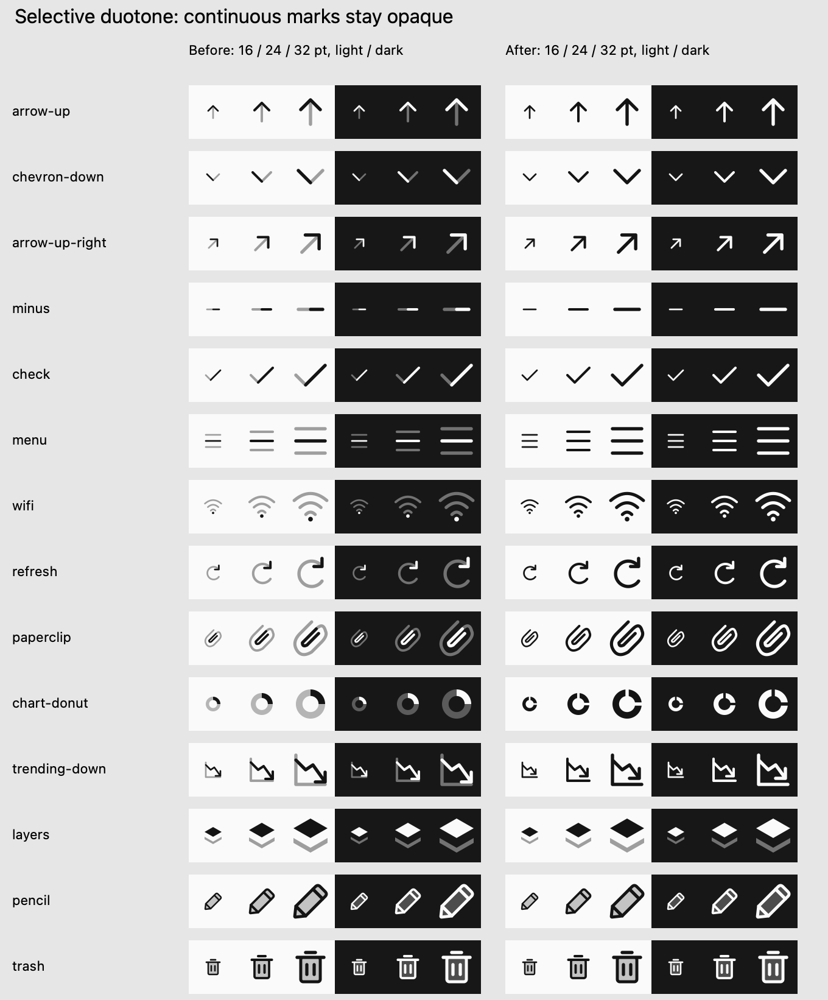

# Selective duotone — 11 November 2026

**Two tones must explain surfaces or depth. Continuous marks use one opaque tint.**
Arrows and chevrons no longer split their shafts, heads or arms into different
tones. The same rule now covers checks, plus/minus, typography, menu lines,
wireless signals, chart axes, rotation arrows and other linear symbols.

## Delivered change

- **118 default icons changed to monochrome.** The remaining 432 defaults retain
  meaningful surface treatment: 350 original body symbols, Layers, and 81 brand
  marks with distinct containing tiles.
- Pencil and Trash are **byte-for-byte unchanged**. Their secondary body fill
  communicates a surface bounded by the primary outline and details.
- Layers retains a receding lower plane and an opaque foreground sheet. It is
  the only explicit non-outlined exception; all new linear recipes default to
  one opaque tint.
- Chart Donut uses opaque sectors separated by radial gaps, preserving its
  structure without arbitrarily fading part of the ring.
- Making Trending Down opaque exposed its pre-existing arrowhead/baseline
  collision. Its head now clears the baseline in **all three styles**. This is
  the only change to Solid or Stroke artwork; the other 936 variants are unchanged.

There are **120 changed source SVGs** in total. The source geometry of the other
116 changed defaults is preserved within export rounding tolerance. Default and
`/duotone` imports remain compatible and select the new selective treatment.
The catalog adds `defaultTone: "monochrome" | "duotone"` for explicit validation.
JS, React, React Native, Swift resources and the offline gallery were regenerated.

## Before and after

The left group shows the previous default and the right group the revised one.
Each group shows 16, 24 and 32 points on light and dark backgrounds, rendered by
AppKit at 2×. The final three examples demonstrate retained surface depth.

## Strict review

Three GPT-6.1 Sol subagents at medium reasoning inspected every changed default
at 16/24/32 points, light/dark, 1×/2×. The coordinator also inspected the comparison
and chart correction. Trending Down received a second review of all three styles
after lifting its arrowhead. All 118 revised defaults and both changed monochrome
variants pass this focused review: 1,440 rendered instances.

[`tone-review.json`](tone-review.json) records every changed name, affected style,
individual assessment, evidence, and previous/current SHA-256 hashes. Native
sheet evidence is under `review/tone-after/{1x,2x}`; baseline SVGs are under
`review/tone-before`. Those directories are local and ignored by Git. The
comparison image is included in the documentation.

This is a focused tone and resulting-clearance review, **not** a replacement for
the [earlier strict design audit](DESIGN-AUDIT-2026-11-11.md). Its Trending Down
collision is corrected; the other geometry and semantic findings remain open.
The original review hashes remain unchanged in `icon-review.json`.
`check-review.py` accepts the follow-up only when both its baseline and current
hashes match, preserving the distinction between a historical full review and
this narrower correction.

## Regression protection and validation

- Linear glyphs are opaque by default; depth exceptions require a named reason.
- Artwork validation rejects any faded layer on a declared monochrome default.
- Regression tests cover complete opaque marks, intact rotation arcs, retained
  Pencil/Trash/Layers surface tones, open Donut divisions and Trending Down
  baseline clearance, in addition to the existing geometry regressions.
- All 14 design regressions and recipe consistency checks pass.
- Full package validation covers all 1,488 SVGs, review hashes, generated exports,
  JavaScript tests, TypeScript, and package dry run.
- Four macOS Swift tests load all styles' vector resources; the iOS Simulator
  package build verifies the generated resources on the other native target.

These are local checks. No release or consumer application update is claimed.
